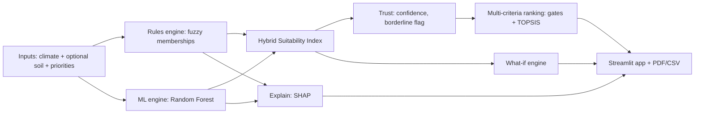

# 1-Slide Architecture Diagram - description

Ready-made image: `docs/architecture_slide.png` (redraw with `python steps/make_architecture_diagram.py`). Use this text if you want to rebuild it in PowerPoint / draw.io.

## Slide title
**Crop Suitability Ranking & Agronomic Recommendation Decision System**
Sub-title: *Hybrid (rules + machine learning) decision support: rank · trust · explain · what-if*

## Layout: 3 columns x 3 rows, arrows left→right, then downward
| | Column 1 (blue) | Column 2 (green) | Column 3 (yellow / pink) |
|---|---|---|---|
| Row 1 | **1 INPUTS** climate (temperature, humidity, rainfall), soil (N, P, K, pH - optional), irrigation, priority weights, optional profit index, missing values allowed | **2a RULES ENGINE** trapezoid membership per crop × feature, weighted geometric mean (Liebig minimum) | **3 HYBRID SUITABILITY INDEX** SI = α·100·P_ml + (1−α)·fuzzy; α, width, sharpness tuned on inner CV with clean AND noisy copies |
| Row 2 | | **2b ML ENGINE** Random Forest (300 trees); forest retrained on available columns when inputs are missing | **4 TRUST** confidence (entropy + margin), borderline flag, tree disagreement, SI P10-P90 → then **5 MULTI-CRITERIA RANKING** hard gates + TOPSIS over SI / water / risk / profit |
| Row 3 | | **6 EXPLAIN** SHAP + fuzzy fit → plain-language reason + limiting factor | **7 WHAT-IF** cheapest N/P/K/pH change for +X points → **8 OUTPUTS** Streamlit app: top-5 table with confidence bars, radar, SHAP chart, live sliders, PDF/CSV |

## Arrows
Inputs → 2a and 2b → 3 → 4 → 5 → 8; 3 → 7 → 8; 2b → 6. Footer line (red italic): *Honest scope: Kaggle Crop Recommendation data (22 crops, 2200 rows, balanced, synthetic-like, India-centric); NPK relative, so kg/ha advice is indicative.*

## Three talking points to say while showing it
1. "Two engines look at the same field: the rules say whether conditions are agronomically sensible, the forest says what the data pattern is. The blend is tuned with noisy data so it survives bad sensors."
2. "Every ranking comes with a trust signal and a reason, and the what-if engine turns the reason into an action."
3. "It still works when the farmer has no soil report - the rules skip missing factors and the model is retrained on the available columns."

## Mermaid version (paste into any Mermaid viewer / GitHub README)

